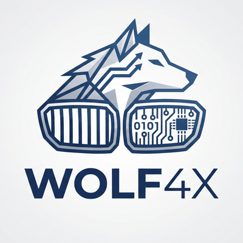

<p align="center">
  <picture>
    <source media="(prefers-color-scheme: dark)" srcset="assets/wolf4x-dark-400.png">
    
  </picture>
</p>

<h1 align="center">Siemens MS42 / MS43 · BMW M52TU / M54</h1>

<p align="center">
  <b>Reverse engineering, tools and documentation<br>for the Siemens MS42 (0110C6) and MS43 (430069) engine control units</b><br>
  <i>Реверс, инструменты и документация для блоков управления мотором Siemens MS42 (0110C6) и MS43 (430069)</i>
</p>

<p align="center">
  
  
  
  <a href="https://github.com/therudywolf/MS4X/actions/workflows/tests.yml"></a>
  
  
  
  <a href="https://boosty.to/therudywolf"></a>
</p>

<p align="center">
  by <b><a href="https://rudywolf.ru">rudywolf</a></b> | <a href="https://github.com/therudywolf">github.com/therudywolf</a> | <a href="https://boosty.to/therudywolf"><b>support on Boosty</b></a> | <a href="https://t.me/rudy_wolf">Telegram</a> | <a href="mailto:alonerudywolf@gmail.com">alonerudywolf@gmail.com</a>
</p>

<p align="center">
  <a href="#english"><b>English</b></a> | <a href="#русский"><b>Русский</b></a>
</p>

---

<a name="english"></a>

## English

The **Siemens MS42** and **MS43** are the engine control units (DME) of the BMW M52TU and M54 straight sixes in the E39, E46, E38, E53 and Z3. Their factory maps are described by the [MS4X wiki](https://www.ms4x.net) and extended by its community patchlists. What was missing is the layer below the maps: a toolchain for the C167 core that reads and runs the actual program, and a plain account of how the ECU checks what it is given. That is what this repository is: a disassembler, an assembler and an emulator for both programs, a checker that tells what is in an image before anything is written to it, and documents that say where the facts come from. It is built the way the gearbox work in [gs860-5hp19](https://github.com/therudywolf/gs860-5hp19) is: every number checked against the binaries, reproducible, tested on every pull request.

### Status: paused

As of 30 October 2026 I am not adding new material here. There has been next to no demand or response, and this is unpaid work that does not pay for itself. What is here stays up and stays correct: error reports are read and fixed, the tests keep running. Custom work goes on as usual, see [Custom work](#custom-work). If this repository is useful to you, a star, an issue with your results or support on [Boosty](https://boosty.to/therudywolf) is what tells me it is worth picking up again.

### What is here

- **[`tools/c166.py`](tools/c166.py)**: disassembler, assembler and code walker for the C166 instruction set of the C167 ([document 01](docs/en/01-c166-tools.md)). One table of instruction forms serves both directions, so whatever it prints assembles back to the same bytes; the stock images of ms4x-net round-trip byte for byte.
- **[`tools/c166emu.py`](tools/c166emu.py)**: an emulator on the same decoder ([document 02](docs/en/02-c166-emulator.md)). It runs the programs' own CRC routines over all 34 stock images and gets the sums the images store, which is how the decoder and the flags were proven.
- **[`tools/ms4x_core.py`](tools/ms4x_core.py) `info`**: what is in an image ([document 03](docs/en/03-image-info-and-patchlists.md)): the program and its labels, every checksum the ECU keeps next to the stored value (the two CRC-16s, and on the MS43 the two 32-bit sums its background task checks), whether the program part is stock, what sits in the free area, which patches of your TunerPro patchlist are applied, partly applied or broken, and what differs from a stock image. It changes nothing.
- **Documents**, English and Russian, the same facts in both: the tools, the memory maps and DPP windows of 0110C6 and 430069, the checksums and how the ECU checks them, the places the community patches take and which of them share bytes, findings in the factory programs, and [document 04](docs/en/04-ms42-core-boundary.md), the rule any own code in the free area has to meet to be safe on a car that is not yours.

### What is not here

The author's own code for these ECUs: it is a product and stays with the author. This repository gives the reverse of the factory programs and the tools to check what anyone builds on them. If you want a build for your car, see [Custom work](#custom-work).

Also not here, ever: firmware dumps, VINs, unit serials, logs with routes; anything about the immobilizer (EWS); switching off emissions monitoring (catalyst, oxygen sensors) or the factory protections (throttle monitoring, knock control, component protection).

The gearbox side lives in [gs860-5hp19](https://github.com/therudywolf/gs860-5hp19).

### Quick start

```bash
python3 tools/ms4x_core.py info my_dump.bin                              # program, checksums, stock or not, free area
python3 tools/ms4x_core.py info my_dump.bin --patchlist patchlist.xdf    # which community patches are applied, and how
python3 tools/ms4x_core.py info my_dump.bin --stock stock.bin            # what differs from a stock image, and why
python3 tools/c166.py dis my_dump.bin 0x10000 0x10080                    # a listing by file offsets
python3 tools/c166emu.py crc my_dump.bin                                 # the CRC routine of the program, run on the image
```

Images are never stored here. The tests download the 34 stock images of ms4x-net by pinned commit and SHA-256 ([`tests/ms4x_images.txt`](tests/ms4x_images.txt)).

### Repository layout

```
tools/               c166.py: disassembler, assembler and code walker (document 01);
                     c166emu.py: emulator on the same decoder (document 02);
                     ms4x_core.py: what is in an image and its patches (document 03)
docs/en, docs/ru     documentation, identical set of files, index in README.md of each folder
tests/               test_repo.py: the repository rules; test_c166.py, test_c166emu.py, test_ms4x_core.py: the
                     instruction table, the emulator and info on the 34 stock images (ms4x_images.txt, downloaded
                     by CI); all run on every pull request
assets/              logo
.github/             issue and pull request templates, funding link, tests workflow
LICENSE, LICENSE-docs Apache-2.0 for the code, CC BY-SA 4.0 for documents and data
NOTICE, CITATION.cff  the credit to keep, a ready citation
SECURITY.md          how to report a dangerous error privately
```

### Disclaimer

This is hobby reverse engineering of a safety-relevant control unit. It may be incomplete or wrong. A bad calibration or patch can damage the engine, drop the unit into limp mode or leave the car immobile. You flash at your own risk, only with your own full dump saved first, and you are responsible for compliance with the law where you live. Siemens, Continental and BMW are trademarks of their owners; this project is not affiliated with them, nor with the MS4X wiki or the ms4x-net project.

### Licence

Use, share and build on everything here, commercially too, **on one condition: credit the author**:

> **rudywolf, https://github.com/therudywolf/MS4X**

| What | Licence | What the credit means in practice |
|---|---|---|
| Code: `tools/`, `tests/` | [Apache License 2.0](LICENSE) | copies and derived tools keep [`NOTICE`](NOTICE) with the credit and say what was changed |
| Documents and data | [CC BY-SA 4.0](LICENSE-docs) | copies and adaptations credit the author, link the licence, say what was changed and stay under CC BY-SA 4.0 |

The WOLF4X name and logo are not licensed for reuse; firmware of Siemens and BMW is not part of this repository ([`NOTICE`](NOTICE)). GitHub offers a ready citation under "Cite this repository" ([`CITATION.cff`](CITATION.cff)).

### Credits

The [MS4X wiki](https://www.ms4x.net) and the [ms4x-net](https://github.com/ms4x-net) repositories: the factory definitions, the reference files and the community patchlists this work builds on. [TunerPro RT](https://www.tunerpro.net): the calibration editor and the XDF format.

AI tools are used for parts of the disassembly, cross-checking and writing. Every number published here is verified against the binaries.

### Support the work

Unpaid hobby research: code disassembled instruction by instruction, every finding checked against the binaries and, wherever possible, on a real car. Everything here stays free and open. If it saved you time, money or an engine, support it on **[Boosty: boosty.to/therudywolf](https://boosty.to/therudywolf)**.

### Custom work

Want a custom tune for the **MS42 / MS43**, a custom tune of the **5HP19** gearbox (GS8.60), or a custom logger for your car? Write to me, I take paid work: Telegram **[t.me/rudy_wolf](https://t.me/rudy_wolf)**, e-mail **[alonerudywolf@gmail.com](mailto:alonerudywolf@gmail.com)**.

---

<a name="русский"></a>

## Русский

**Siemens MS42** и **MS43** — блоки управления мотором (DME) рядных шестёрок BMW M52TU и M54 на E39, E46, E38, E53 и Z3. Их заводские карты описаны в [вики MS4X](https://www.ms4x.net) и дополнены патчлистами сообщества. Не хватало слоя под картами: инструментов для ядра C167, которые читают и исполняют саму программу, и внятного рассказа о том, как блок проверяет то, что ему дали. Это и есть этот репозиторий: дизассемблер, ассемблер и эмулятор для обеих программ, проверялка, которая говорит, что лежит в образе, прежде чем в него что-то писать, и документы, где у каждого факта есть источник. Сделано так же, как работа по коробке в [gs860-5hp19](https://github.com/therudywolf/gs860-5hp19): каждое число сверено по бинарникам, воспроизводимо, проверяется в каждом pull request.

### Статус: пауза

С 30 октября 2026 года новое сюда не добавляю. Запроса и отклика почти нет, а это неоплачиваемая работа, которая себя не окупает. То, что здесь есть, остаётся и поддерживается в верном виде: сообщения об ошибках читаю и исправляю, тесты продолжают работать. Работа на заказ идёт как обычно, см. [Работа на заказ](#работа-на-заказ). Если репозиторий вам полезен, звезда, issue с вашими результатами или поддержка на [Boosty](https://boosty.to/therudywolf) — то, по чему я пойму, что к нему стоит вернуться.

### Что здесь есть

- **[`tools/c166.py`](tools/c166.py)**: дизассемблер, ассемблер и обход кода для набора команд C166 в C167 ([документ 01](docs/ru/01-c166-tools.md)). Одна таблица форм команд работает в обе стороны: что он печатает, то и собирается обратно в те же байты; заводские образы ms4x-net проходят круг байт в байт.
- **[`tools/c166emu.py`](tools/c166emu.py)**: эмулятор на том же декодере ([документ 02](docs/ru/02-c166-emulator.md)). Он исполняет собственные подпрограммы CRC программ на всех 34 заводских образах и получает суммы, записанные в образах; так доказаны декодер и флаги.
- **[`tools/ms4x_core.py`](tools/ms4x_core.py) `info`**: что лежит в образе ([документ 03](docs/ru/03-image-info-and-patchlists.md)): программа и её метки, каждая сумма, которую держит блок, рядом с записанной (две CRC-16, а у MS43 ещё две 32-битные суммы его фоновой задачи), заводская ли программная часть, что лежит в свободной области, какие патчи вашего патчлиста TunerPro стоят, стоят частично или сломаны, и чем образ отличается от заводского. Ничего не меняет.
- **Документы**, на русском и английском, одни и те же факты: инструменты, карты памяти и окна DPP 0110C6 и 430069, контрольные суммы и как блок их проверяет, места патчей сообщества и какие из них делят байты, находки в заводских программах и [документ 04](docs/ru/04-ms42-core-boundary.md) — правило, которому должен отвечать любой свой код в свободной области, чтобы быть безопасным на чужой машине.

### Чего здесь нет

Собственного кода автора для этих блоков: это продукт, и он остаётся у автора. Репозиторий даёт реверс заводских программ и инструменты проверить то, что на них строят. Если нужна сборка под вашу машину — [Работа на заказ](#работа-на-заказ).

И не будет никогда: дампов прошивок, VIN, серийных номеров блоков, логов с маршрутами; ничего про иммобилайзер (EWS); отключения контроля экологии (катализатор, лямбда-зонды) и заводских защит (контроль дросселя, детонации, защита компонентов).

Коробочная часть — в [gs860-5hp19](https://github.com/therudywolf/gs860-5hp19).

### Быстрый старт

```bash
python3 tools/ms4x_core.py info my_dump.bin                              # программа, суммы, заводская ли, свободная область
python3 tools/ms4x_core.py info my_dump.bin --patchlist patchlist.xdf    # какие патчи сообщества стоят и как
python3 tools/ms4x_core.py info my_dump.bin --stock stock.bin            # чем образ отличается от заводского и почему
python3 tools/c166.py dis my_dump.bin 0x10000 0x10080                    # листинг по смещениям в файле
python3 tools/c166emu.py crc my_dump.bin                                 # подпрограмма CRC программы, исполненная на образе
```

Образы здесь не хранятся. Тесты скачивают 34 заводских образа ms4x-net по закреплённому коммиту и SHA-256 ([`tests/ms4x_images.txt`](tests/ms4x_images.txt)).

### Структура репозитория

```
tools/               c166.py: дизассемблер, ассемблер и обход кода (документ 01);
                     c166emu.py: эмулятор на том же декодере (документ 02);
                     ms4x_core.py: что лежит в образе и его патчи (документ 03)
docs/en, docs/ru     документация, одинаковый набор файлов, оглавление в README.md каждой папки
tests/               test_repo.py: правила репозитория; test_c166.py, test_c166emu.py, test_ms4x_core.py: таблица
                     команд, эмулятор и info на 34 заводских образах (ms4x_images.txt, их скачивает CI); все
                     запускаются в каждом pull request
assets/              логотип
.github/             шаблоны issue и pull request, ссылка на поддержку, тесты
LICENSE, LICENSE-docs Apache-2.0 на код, CC BY-SA 4.0 на документы и данные
NOTICE, CITATION.cff  указание автора, которое нужно сохранять, готовая ссылка для цитирования
SECURITY.md          как лично сообщить об опасной ошибке
```

### Ответственность

Это любительский реверс блока, отвечающего за безопасность. Он может быть неполным или ошибочным. Неудачная калибровка или патч может повредить мотор, отправить блок в аварийный режим или оставить машину без хода. Вы прошиваете на свой риск, только сохранив собственный полный дамп, и сами отвечаете за соблюдение законов своей страны. Siemens, Continental и BMW — товарные знаки их владельцев; проект не связан ни с ними, ни с вики MS4X, ни с проектом ms4x-net.

### Лицензия

Всё здесь можно использовать, распространять и дорабатывать, в том числе в коммерческих целях, **при одном условии: указывать автора**:

> **rudywolf, https://github.com/therudywolf/MS4X**

| Что | Лицензия | Что значит указание автора на деле |
|---|---|---|
| Код: `tools/`, `tests/` | [Apache License 2.0](LICENSE) | копии и производные инструменты сохраняют [`NOTICE`](NOTICE) с указанием автора и сообщают, что изменено |
| Документы и данные | [CC BY-SA 4.0](LICENSE-docs) | копии и переработки указывают автора, дают ссылку на лицензию, сообщают, что изменено, и выходят под CC BY-SA 4.0 |

Имя и логотип WOLF4X для повторного использования не лицензируются; прошивок Siemens и BMW в репозитории нет ([`NOTICE`](NOTICE)). Готовая ссылка для цитирования — кнопка «Cite this repository» на GitHub ([`CITATION.cff`](CITATION.cff)).

### Благодарности

[Вики MS4X](https://www.ms4x.net) и репозитории [ms4x-net](https://github.com/ms4x-net): заводские определения, эталонные файлы и патчлисты сообщества, на которых строится эта работа. [TunerPro RT](https://www.tunerpro.net): редактор калибровок и формат XDF.

Часть дизассемблирования, перекрёстных проверок и текста делается с помощью ИИ-инструментов. Каждое опубликованное здесь число проверяется по бинарникам.

### Поддержать

Это хобби-исследование без бюджета: код разбирается инструкция за инструкцией, каждая находка проверяется по бинарникам и, где можно, на живой машине. Всё здесь остаётся бесплатным и открытым. Если это сэкономило вам время, деньги или мотор, поддержите на **[Boosty: boosty.to/therudywolf](https://boosty.to/therudywolf)**.

### Работа на заказ

Нужен кастомный тюн **MS42 / MS43**, кастомный тюн коробки **5HP19** (GS8.60) или свой логгер под машину? Напишите мне, готов взять работу платно: Telegram **[t.me/rudy_wolf](https://t.me/rudy_wolf)**, почта **[alonerudywolf@gmail.com](mailto:alonerudywolf@gmail.com)**.
